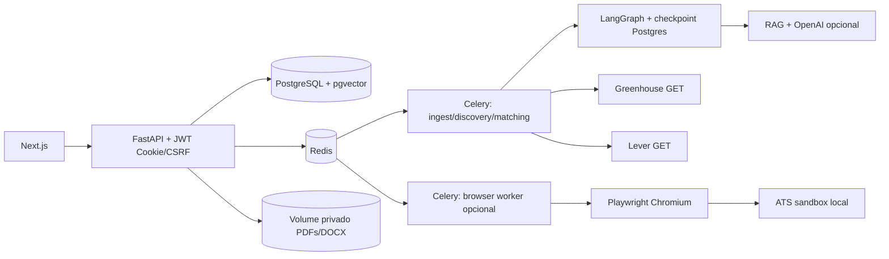

# AutoApply AI — SaaS MVP com IA, LangGraph e automação supervisionada

Projeto de referência **executável localmente** para descoberta de vagas, processamento de currículos, matching, respostas com RAG, aprovação humana e submissão **somente em um ATS fictício (sandbox)** via Playwright.

> **Importante:** é um MVP/POC funcional, não um serviço comercial pronto para produção. Não contém bypass de CAPTCHAs, scraping de áreas autenticadas do LinkedIn/Indeed nem submissão a ATS reais sem autorização. Google/LinkedIn OAuth, billing, observabilidade avançada, migrações Alembic e revisão jurídica continuam no backlog.

## Início rápido (Docker)

**Pré-requisitos:** Docker Engine ou Docker Desktop com Docker Compose v2. Reserve espaço para o browser image do Playwright caso queira testar o envio automatizado.

```bash
cp .env.example .env
# Edite JWT_SECRET e POSTGRES_PASSWORD no arquivo .env
# Inicia API, banco, Redis, worker Celery e Next.js:
docker compose up --build -d
```

Abra:

- **Frontend:** http://localhost:3000
- **Swagger da API:** http://localhost:8000/docs
- **Healthcheck:** http://localhost:8000/health

Crie uma conta pela própria interface. O sistema já inclui cinco vagas **fictícias**, identificadas como `sandbox`, para testar sem depender de sites externos.

Para **testar o preenchimento e a submissão automática do formulário fictício** com Playwright, ligue também o browser worker:

```bash
docker compose --profile browser up --build -d
```

Esse perfil baixa a imagem do navegador e pode consumir mais recursos. Se você não o iniciar, o restante do produto funciona; o envio sandbox ficará na fila `browser` aguardando o worker.

### Primeira experiência (end-to-end)

1. Cadastre sua conta em `localhost:3000`.
2. Abra **Meu perfil**, preencha nome, cargo e habilidades, e clique em **Salvar perfil**.
3. Envie um arquivo PDF ou DOCX. Aguarde a conclusão (o painel atualiza aproximadamente a cada 9 segundos) e clique **Usar dados**. Sem chave de IA, a extração é heurística e requer revisão.
4. Abra **Explorar vagas**. Há cinco vagas fictícias cadastradas; para consultar fontes públicas, veja abaixo.
5. Clique **Preparar** em uma vaga. O worker roda um workflow LangGraph, calcula matching e gera rascunhos fundamentados no perfil.
6. Em **Candidaturas**, abra a candidatura que aparece como **Aguardando revisão**, edite as respostas e aprove.
7. No sandbox, clique **Enviar para ATS de teste** (precisa do `browser-worker` ativo). Playwright abre um formulário hospedado pela própria API, preenche nome, e-mail, motivação e anexa o currículo. O recibo `SANDBOX-...` é registrado.
8. Para vagas externas, a aplicação só oferece **Abrir site oficial** e **Registrei o envio manual**. Nenhum envio real ocorre automaticamente.

## IA opcional / modo sem chave

Configure em `.env`:

```dotenv
OPENAI_API_KEY=sk-...
OPENAI_CHAT_MODEL=gpt-4.1-mini
```

Com a chave, o sistema usa um LLM para extração profissional, embeddings `text-embedding-3-small` (1536 dimensões), recuperação com pgvector e geração de rascunhos com evidências. Sem a chave, continua funcional com extração heurística, ranking lexical e respostas-modelo claramente marcadas para revisão. **O modo sem chave não oferece busca semântica avançada nem geração generativa real.**

A seleção exata de modelos deve ser ajustada conforme preços, permissões e disponibilidade da conta. Não registre chaves no Git nem no frontend.

## Fontes de vagas autorizadas e importação universal

Configure os identificadores públicos de boards em `.env` (Remotive já vem habilitado por padrão):

```dotenv
GREENHOUSE_BOARDS=exemplo1,exemplo2
LEVER_SITES=exemplo3
ASHBY_BOARDS=exemplo4
REMOTIVE_ENABLED=true
ARBEITNOW_ENABLED=false
```

Além das fontes automáticas, você pode clicar em **Importar / Nova vaga** na interface para:
- **Importar por URL**: ler metadados públicos (`JSON-LD JobPosting` / `OpenGraph`) de qualquer portal aberto.
- **Cadastrar manualmente**: colar título, empresa, link e descrição de vagas que exigem login (LinkedIn, Gupy, Workday etc.).

Em **Candidaturas**, o modal oferece 3 abas:
1. **Revisão & IA**: edite respostas, adicione novas perguntas reais do formulário em tempo real, gere/edite a **Carta de Apresentação (Cover Letter)** e use **Reprocessar com IA** em caso de falha.
2. **Kit 1-Clique & Envio**: copie qualquer dado do perfil, carta ou resposta com 1 clique para preencher plataformas externas, ou execute o envio Playwright no ATS sandbox.
3. **Feedback & Pipeline**: visualize o **screenshot de confirmação** capturado pelo Playwright, atualize etapas pós-envio (`Confirmada`, `Triagem`, `Entrevista`, `Teste técnico`, `Proposta`, `Recusada`), salve protocolo/notas/follow-up e acompanhe a **timeline completa de auditoria**.

Clique **Buscar novas vagas**. O backend usa apenas **endpoints públicos de leitura** documentados do Greenhouse e Lever. Um board inválido é ignorado e os erros são devolvidos ao worker (veja os logs):

```bash
docker compose logs -f worker
```

O código de descoberta não submete candidaturas externas e não tenta contornar bloqueios, logins ou CAPTCHAs. A execução comercial depende de análise dos termos aplicáveis e, para envio via API, de credenciais e permissões apropriadas.

## Arquitetura



O estado de candidaturas é persistido no banco, bem como os checkpoints LangGraph via `PostgresSaver`. As aprovações humanas são retomadas pelo mesmo `thread_id` da candidatura. A submissão é uma operação **externa ao grafo**, protegida por estado de aplicação, evitando reexecução do envio durante uma retomada.

## Tecnologias

| Área | Stack |
| --- | --- |
| Interface | Next.js 15, React 19, TypeScript, CSS nativo, Lucide |
| API | FastAPI, Pydantic 2, JWT (cookie HttpOnly + token CSRF) |
| Banco | PostgreSQL 16 + pgvector, SQLAlchemy 2 |
| Orquestração | LangGraph + checkpoint PostgreSQL |
| Fila | Redis 7 + Celery 5 |
| Arquivos | Volume local isolado por usuário (substituir por S3 em produção) |
| Currículos | PyMuPDF, python-docx, extração LLM opcional |
| RAG | OpenAI embeddings + pgvector, fallback lexical |
| Browser | Playwright Chromium apenas para formulário sandbox próprio |
| Implantação | Docker Compose, Dockerfiles distintos API/browser |

## Principais rotas

| Método | Endpoint | Uso |
| --- | --- | --- |
| POST | `/api/v1/auth/register` | Criar conta |
| POST | `/api/v1/auth/login` | Login |
| POST | `/api/v1/auth/logout` | Logout |
| GET | `/api/v1/auth/me` | Sessão |
| GET, PUT | `/api/v1/profile` | Perfil profissional |
| GET, POST | `/api/v1/resumes` | Listar/upload de currículos |
| POST | `/api/v1/resumes/{id}/confirm` | Confirmar extração (`overwrite` opcional) |
| DELETE | `/api/v1/resumes/{id}` | Excluir currículo |
| GET | `/api/v1/jobs` | Vagas com filtro por texto, modalidade e fonte |
| POST | `/api/v1/jobs/discover` | Busca assíncrona nas fontes públicas |
| GET | `/api/v1/jobs/discover/status/{task_id}` | Status e erros da busca assíncrona |
| POST | `/api/v1/jobs/import-url` | Importar qualquer vaga pública por URL |
| POST | `/api/v1/jobs/manual` | Cadastrar vaga manualmente |
| GET | `/api/v1/jobs/{id}` | Detalhes da vaga |
| GET, POST | `/api/v1/applications` | Listar/criar candidaturas (com perguntas customizadas e cover letter) |
| GET, DELETE | `/api/v1/applications/{id}` | Status, respostas e exclusão |
| GET | `/api/v1/applications/{id}/events` | Timeline de auditoria |
| POST | `/api/v1/applications/{id}/approve` | Retomar interrupt LangGraph |
| POST | `/api/v1/applications/{id}/retry` | Reprocessar candidatura com falha/rejeitada |
| POST | `/api/v1/applications/{id}/questions` | Adicionar pergunta da vaga e gerar resposta com RAG |
| POST | `/api/v1/applications/{id}/submit-sandbox` | Playwright no ATS fictício com captura de screenshot |
| GET | `/api/v1/applications/{id}/proof` | Comprovante visual (PNG) capturado no envio |
| POST | `/api/v1/applications/{id}/mark-manual` | Informar envio manual com protocolo/notas opcionais |
| PATCH | `/api/v1/applications/{id}/tracking` | Atualizar etapa pós-envio, protocolo, notas e follow-up |
| GET | `/api/v1/metrics` | Resumo por estado e etapa pós-envio |
| GET | `/api/v1/privacy/export` | Exportação JSON dos dados |
| DELETE | `/api/v1/privacy/account` | Excluir conta e registros ativos |
| GET | `/health` | Healthcheck |

A documentação interativa está em `/docs`. Para mutações pelo Swagger, forneça um cookie de sessão e o header `x-csrf-token`; o fluxo web já cuida disso automaticamente.

## CI/CD

O repositório contém `.github/workflows/ci.yml`: em pull requests e pushes para `main`, executa testes unitários em Python, verificações de erros críticos, TypeScript e build Next.js. O deploy não está configurado para impedir publicações acidentais de uma POC.

## Testes

Em um ambiente Python 3.12/3.13:

```bash
cd backend
python -m venv .venv
source .venv/bin/activate
pip install -r requirements-dev.txt
pytest -q
ruff check app tests
```

Testes de integração com DB, worker, browser e operações reais devem ser executados num ambiente isolado usando `docker compose` e **sem credenciais de portais de empregos**. Os testes presentes no ZIP cobrem matching, normalização, extração, dados do sandbox e a política de aprovação LangGraph.

## Limitações e itens necessários antes de produção

1. **Migrações:** o MVP cria as tabelas automaticamente no startup. Antes de produção, introduza Alembic e migrations versionadas.
2. **Storage:** os arquivos usam volume Docker compartilhado. Para múltiplos hosts, substitua por S3 compatível, criptografia e links temporários.
3. **Segredos e sessão:** configure um secret forte, TLS, `SECURE_COOKIES=true`, domínio próprio, política CSP e proteção contra abuso nas rotas de autenticação.
4. **Compliance:** implemente termos, base legal LGPD, retenção, exclusão integral (inclusive checkpoints, backups e embeddings), portabilidade, incident response e avaliação de fornecedores.
5. **Operação:** tracing, alertas, DLQ, deduplicação distribuída, métricas, retry controlado e reconciliação dos estados `unknown`.
6. **Conectores:** apenas leitura pública de Greenhouse/Lever está implementada. Submissão a plataformas reais exige autorização contratual e adaptações por ATS.
7. **Validação das respostas:** evidências são recuperadas e associadas, mas não há verificador independente de factualidade. Aprovação humana é obrigatória.
8. **Matching:** o rank lexical é um baseline simples. Não está calibrado com dados reais e não incorpora filtros eliminatórios complexos.
9. **SSRF e arquivos:** os hosts ATS estão fixos e tokens de board têm allowlist; para escala comercial adicione malware scanning, tipos MIME de fato, OCR isolado e políticas de rede.
10. **Privacidade de IA:** antes de inserir informações reais, revise os contratos e as configurações de retenção/treinamento do provedor LLM.
11. **Idempotência:** o sandbox retorna o mesmo recibo por candidatura, mas integrações externas exigem estratégias de reconciliação específicas.
12. **Formulário frontend:** a API aceita outros campos do perfil além dos mostrados na UI (formação, idiomas etc.). Expandir onboarding é tarefa de produto.

## Referências de integração

- Greenhouse Job Board API: https://developers.greenhouse.io/job-board.html
- Lever Postings API: https://github.com/lever/postings-api
- LangGraph interrupts: https://docs.langchain.com/oss/python/langgraph/interrupts

## Licença

MIT para o código da demonstração. Não concede autorização para operar em serviços terceiros.
