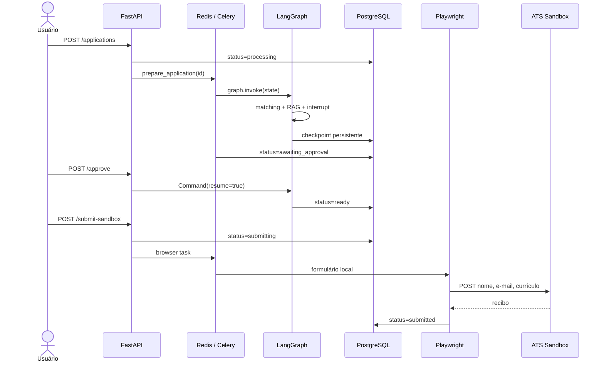

# Notas de arquitetura e extensibilidade

## Bounded contexts

- `auth`: sessões e identidade. Trocar por OIDC/IdP quando necessário.
- `profiles`: dados profissionais e versionamento.
- `resumes`: upload, parsing e confirmação.
- `jobs`: ingestão normalizada e baseline de matching.
- `rag`: facts versionados, embeddings opcionais e respostas com evidências.
- `agents`: LangGraph com interrupção para revisão.
- `applications`: estado transacional, auditoria e operações de envio.
- `sandbox`: único adapter de escrita automática nesta POC.

## Sequência de aplicação

## Integrar um novo ATS

1. Validar documentação, termos, rate limit e tipo de permissão (leitura vs. submissão).
2. Definir identificador externo estável para deduplicar.
3. Implementar mapper para `Job` e acrescentar conector à rotina `discover`.
4. Para API de submissão autorizada, implementar `submit` em processo dedicado. A operação deve ser idempotente no aplicativo, produzir recibo verificável e nunca ser executada diretamente pelo LLM.
5. Testar contratos e casos `UNKNOWN` antes de liberar clientes.
6. Alterar o gate de política de submissão para permitir apenas integrações explicitamente habilitadas.

## Estratégia de produção

- Managed PostgreSQL com backup/point-in-time recovery e criptografia.
- Object storage privado e antivírus/varredura assíncrona.
- Workers escalonados por fila com limites próprios por domínio.
- RBAC por usuário/organização e Row Level Security quando adequado.
- Transactional outbox e reconciliação após quedas.
- Tracing e métricas com retenção sem dados pessoais ou prompts completos.
- Testes de segurança específicos contra prompt injection em descrição de vagas.
- Rotinas de exclusão de dados incluindo checkpointer do LangGraph.
